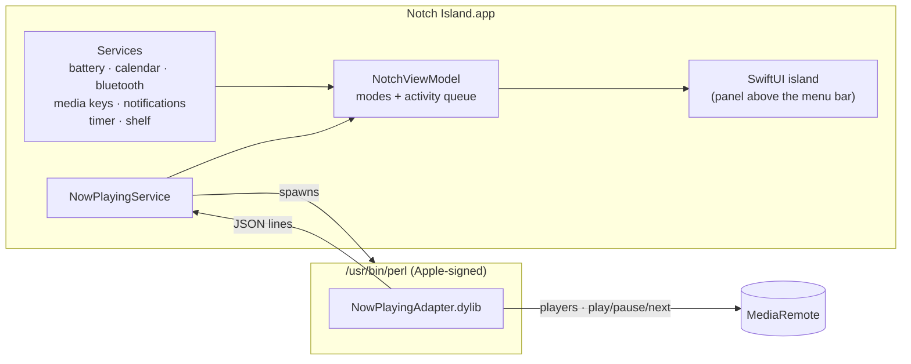

<div align="center">

# 🏝️ Notch Island

**A Dynamic Island for your MacBook's notch — native, tiny, private.**

Music from every app, notifications, calendar, AirPods & Bluetooth, volume and brightness, a file shelf and a focus timer —
all living in the notch. Built in Swift & SwiftUI. No network. No tracking. No third-party code.


</div>

---

## ✨ Features

| | |
|---|---|
| 🎵 **Now Playing, everywhere** | Spotify, YouTube in Chrome/Safari, Apple Music, podcasts — anything that shows up in Control Center. Artwork + a live equalizer beside the notch. |
| 🔀 **Multiple players** | Playing in two apps? App tabs switch between them, or **swipe with two fingers** on the open island. Starting music elsewhere switches automatically. |
| ⏯️ **Media controls** | Previous / play-pause / next, sent to the exact app you're looking at, with a live progress bar. |
| 🔔 **Notifications** | WhatsApp, Messages, Mail… banners appear in the island. Click to open the app. *(opt-in)* |
| 📅 **Calendar** | Your next events with times and **Join** buttons for Zoom / Meet / Teams links; a countdown beside the notch 10 minutes before, and a card when it starts. *(opt-in)* |
| 🎧 **Logitech G headsets** | G733 / G935 / G Pro X on a LIGHTSPEED receiver: battery % beside the Mac's, a card when the headset turns on or off, low-battery warnings. Read directly over HID++ — no G HUB. |
| 🔵 **Bluetooth** | Earbuds, AirPods, keyboards and mice get a connect / disconnect card — with left / right / case battery when reported. *(opt-in)* |
| 🔊 **Volume & brightness HUD** | Island-style level bars. Optionally replaces Apple's on-screen HUD entirely. *(opt-in)* |
| ⚡ **Battery** | Charging animation when you plug in, low-battery warnings at 20 % and 10 %, and a "fully charged" card. |
| 🗂️ **File shelf** | Drag files onto the notch to park them. Drag them back out later, open them, or **AirDrop** them. |
| ⏱️ **Focus timer** | Pomodoro presets; the countdown lives beside the notch and rings when it's done. |
| 🖱️ **Hover to expand** | Point at the notch — it springs open with a subtle trackpad haptic. Move away and it tucks back in. |
| ⚙️ **Settings** | Every feature can be switched on or off. Anything that needs a macOS permission starts **off**. |

## 🧭 Interaction

```
  pointer on notch   ──▶  opens: Media · Calendar · Shelf · Timer tabs
  two-finger swipe   ──▶  next / previous music player
  drag a file up     ──▶  island opens on the Shelf, drop to keep it
  plug in charger    ──▶  charging card for ~4.5 s
  menu bar capsule   ──▶  Settings… · Preview every card · Open at Login · Quit
```

## 📦 Install

### Download

Grab `NotchIsland.zip` from the [latest release](https://github.com/gangireddymayur/notch-island/releases/latest), unzip it and move **Notch Island.app** to Applications.

> The release is built by GitHub Actions from this exact source, but it isn't notarized by Apple (that needs a paid developer account).
> The first time, **right-click the app → Open → Open**. Or run:
> ```bash
> xattr -dr com.apple.quarantine "/Applications/Notch Island.app"
> ```

### Build from source

Needs **macOS 14+** and the **Xcode command line tools**. A notch is optional — on other displays the island sits under the menu bar.

```bash
git clone https://github.com/gangireddymayur/notch-island.git
cd notch-island
./build.sh --install     # builds, copies to ~/Applications, launches
```

The first launch registers it to open at login — toggle that in Settings.

## 🔒 Privacy & security

Notch Island is small enough to read in an afternoon, and it asks for as little as possible.

| Feature | How it works | Permission |
|---|---|---|
| Island, hover, shelf drag | Pointer position (no keystrokes) | none |
| Battery cards | IOKit power-source API | none |
| Music & media keys | Apple's MediaRemote framework (see below) | none |
| Volume HUD (beside Apple's) | CoreAudio volume listener | none |
| Replace Apple's HUD | Event tap for **only** the volume, mute & brightness keys | Accessibility |
| Notifications | Reads the text of macOS's own banners | Accessibility |
| Calendar | EventKit, read-only | Calendars |
| Bluetooth cards | IOBluetooth connect notifications | Bluetooth |
| Logitech headset battery | HID++ battery query to the Logitech receiver only | none |

- ❌ No network code at all
- ❌ No analytics, no third-party packages
- ✅ Every permission-based feature is **off by default**

> Building from source signs the app ad-hoc, so macOS treats every rebuild as a new app — after rebuilding, toggle Notch Island off and on again in *Privacy & Security → Accessibility*.

## 🛠️ How it works



**The island** is one borderless panel that floats above the menu bar. It ignores the mouse everywhere except inside the black shape, so it never gets in the way. A small state machine decides what to show:

```
hover / file drag  >  pop-up card (one at a time)  >  timer  >  meeting soon  >  music  >  closed
```

**Now Playing.** Since macOS 15.4, only Apple-signed processes may read *Now Playing*. `/usr/bin/perl` is Apple-signed, so the app runs a ~270-line Objective-C adapter inside it. The adapter lists every app with a media session, resolves each one's player, and prints a JSON line whenever anything changes. It accepts exactly five commands — play, pause, toggle, next, previous — aimed at a single app.

> ⚠️ MediaRemote, DisplayServices (brightness) and the notification-banner layout are private to Apple and may change with a future macOS update.

### Project layout

```
Adapter/                    MediaRemote bridge (runs inside /usr/bin/perl)
Sources/NotchIsland/
  main.swift                app delegate, menu bar menu, previews
  AppSettings.swift         preferences (permission features default off)
  NotchViewModel.swift      modes, pages, activity queue, sizes
  NotchWindowController     panel, hover, click-through, swipe, file drag
  NotchShape.swift          the notch outline with animatable corners
  Services/                 NowPlaying · Battery · Calendar · Bluetooth · LogitechHeadset ·
                            MediaKeys (volume/brightness) · Notifications ·
                            Timer · Shelf
  Views/                    root, compact wings, cards, expanded pages, settings
.github/workflows/          release build on version tags
build.sh                    build, bundle, sign, install
```

## 🚢 Releasing

```bash
git tag v0.2.0 && git push origin v0.2.0
```

GitHub Actions builds the app on macOS, zips it and publishes a release with a SHA-256 checksum.

## 🗺️ Ideas

- [ ] Notarized builds (Apple Developer account)
- [ ] Artwork-tinted colors
- [ ] Seek by dragging the progress bar
- [ ] Hide during full-screen video

## 📄 License

[MIT](LICENSE) © Mayur
