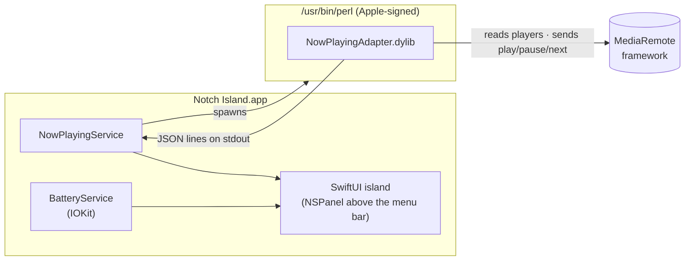

<div align="center">

# 🏝️ Notch Island

**A Dynamic Island for your MacBook's notch — native, tiny, private.**

Now playing from every app, live media controls, and a charging animation that drops out of the notch.
Built in Swift & SwiftUI. No network. No tracking. No third-party code.


</div>

---

## ✨ Features

| | |
|---|---|
| 🎵 **Now Playing, everywhere** | Spotify, YouTube in Chrome/Safari, Apple Music, podcasts — anything that shows up in Control Center. |
| 🔀 **Multiple players** | Playing in two apps at once? App tabs let you switch, or **swipe with two fingers** on the open island. Starting music in another app switches automatically. |
| ⏯️ **Media controls** | Previous / play-pause / next, sent to the exact app you're looking at. Live progress bar. |
| 🎚️ **Live wings** | While music plays, the notch grows small wings: artwork on the left, a dancing equalizer on the right. |
| ⚡ **Charging animation** | Plug in and the island drops open: a battery fills up, the percentage rolls up, and macOS's time-to-full estimate appears. |
| 🖱️ **Hover to expand** | Move the pointer to the notch — it springs open with a subtle trackpad haptic. Move away and it tucks back in. |
| 🚀 **Starts at login** | Lives quietly in the menu bar (capsule icon) with *Open at Login* and *Quit*. |

## 🧭 Interaction

```
  pointer on notch ──▶  expands (player · tabs · battery)
  two-finger swipe ──▶  next / previous player
  click artwork    ──▶  opens the source app
  plug in charger  ──▶  charging card for ~4.5 s
```

## 📦 Install

Requirements: a Mac running **macOS 14 or later** (a notch is optional — on other displays it shows as a pill under the menu bar) and **Xcode command line tools**.

```bash
git clone https://github.com/gangireddymayur/notch-island.git
cd notch-island
./build.sh --install
```

That builds `Notch Island.app`, copies it to `~/Applications` and launches it.
The first launch registers it to open at login — toggle that from the menu bar icon.

> The app is ad-hoc signed for your own Mac. It is not notarized, so it isn't meant to be passed around as a pre-built download — build it yourself from source.

## 🔒 Privacy & security

Notch Island was written to be small enough to read in one sitting.

| What it touches | How | Permission prompt? |
|---|---|---|
| Pointer position | `NSEvent` mouse-moved monitor (no keystrokes) | None |
| Battery level & charging | IOKit power-source API | None |
| Now playing + media commands | Apple's MediaRemote framework (see below) | None |
| Login item | `SMAppService` | macOS notification only |

- ❌ No network code at all
- ❌ No Accessibility, Full Disk Access, Screen Recording or keyboard access
- ❌ No analytics, no third-party packages

## 🛠️ How it works



Since macOS 15.4, only Apple-signed processes may read *Now Playing* information. `/usr/bin/perl` is Apple-signed,
so the app runs a ~250-line Objective-C adapter inside it. The adapter:

- lists every app with a media session (`MRMediaRemoteGetNowPlayingClients`),
- resolves each app's player and reads its title, artist, artwork, position and play state,
- prints one JSON line whenever anything changes (artwork bytes only when they change),
- accepts exactly five commands — play, pause, toggle, next, previous — aimed at a single app.

> ⚠️ MediaRemote is a private framework. A future macOS update could change or close this path.

### Project layout

```
Adapter/
  NowPlayingAdapter.m     MediaRemote bridge (runs inside /usr/bin/perl)
  adapter.pl              6-line loader
Sources/NotchIsland/
  main.swift              app delegate, menu bar icon, login item
  NotchWindowController   floating panel, hover & swipe handling
  NotchViewModel          island state machine (closed · music · charging · expanded)
  NotchView               all SwiftUI views and animations
  NotchShape              the notch outline with animatable corners
  NowPlayingService       adapter process, player list, switching
  BatteryService          IOKit power notifications
Resources/Info.plist      menu-bar-only app (LSUIElement)
build.sh                  build, bundle, sign, install
```

## 🗺️ Roadmap

- [ ] Notifications in the island (opt-in)
- [ ] Calendar: next event beside the notch
- [ ] AirPods / Bluetooth connect animation
- [ ] Volume & brightness HUD replacement
- [ ] File shelf — drag files onto the notch
- [ ] Settings window

## 📄 License

[MIT](LICENSE) © Mayur
